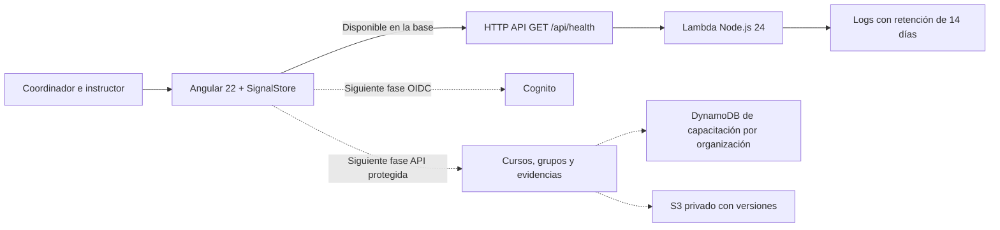

# Arquitectura de Capacitación y Evidencias

## Contexto y frontera

El producto administra evidencia de formación interna por organización. La consola Angular 22.3 y NgRx SignalStore 22.0.1 usa una API HTTP. La porción actual implementa la salud del proceso y una regla de vigencia ejecutable en Node.js. El entorno AWS reservado por SAM contiene un HTTP API, una Lambda, una tabla DynamoDB y un bucket S3.

La plantilla crea exclusivamente la ruta pública `GET /api/health`. La Lambda recibe `STAGE` y `PRODUCT_SLUG` y su rol puede escribir en su grupo de logs. La tabla y el bucket carecen de un handler de negocio en esta fase. Cognito y los autorizadores se incorporarán junto con las rutas protegidas.

[Fuente del diagrama](./diagram.mmd)

## Datos, pertenencia y documentos

| Entidad | Partición propuesta | Ordenamiento propuesto | Propietario |
| --- | --- | --- | --- |
| Miembro | `ORG#org` | `MEMBER#sub` | Organización y rol verificados. |
| Revisión de curso | `ORG#org#COURSE#course` | `REV#revision` | Curso con política de vigencia inmutable. |
| Grupo | `ORG#org` | `GROUP#group` | Coordinador e instructores asignados. |
| Inscripción | `ORG#org#GROUP#group` | `PERSON#person` | Pertenencia al grupo. |
| Evidencia | `ORG#org#PERSON#person` | `COURSE#course#REV#revision#EVIDENCE#id` | Realización y decisiones versionadas. |
| Recibo | `ORG#org` | `IDEMP#actor#operation#digestKey` | Resultado de un comando repetido. |

Los identificadores de organización de la URL se verifican frente al `sub` de Cognito y la membresía actual. El acceso a un participante depende además del grupo y del rol. Los datos de persona se reducen al identificador interno y al nombre necesario para el reporte. La aplicación aplica paginación y consulta por claves.

Un archivo entra en `staging/` con límite de tamaño, extensiones y URL firmada breve después de autorizar a la persona. Antes de registrar evidencia, el servidor comprueba tipo, tamaño e integridad de la versión del objeto. Copia esa versión a `evidence/org/.../` y guarda ID de versión, hash y tamaño en la tabla. Una lectura privada se autoriza en cada solicitud. El nombre original y el contenido del documento quedan fuera de los logs.

## Regla implementada y transacciones futuras

`services/domain/course-evidence.mjs` recibe una revisión de curso con `id`, `revision` y `validityDays`, una realización con el curso y revisión correspondientes, fecha de realización y revocación explícita, y la fecha de consulta. Usa fechas civiles `YYYY-MM-DD`, validadas contra el calendario y comparadas en UTC. La fecha final se calcula sumando días de calendario a la realización. El día final es vigente. `validityDays: null` conserva la realización sin vencimiento.

El evaluador devuelve `missing`, `wrong-course`, `wrong-revision`, `revoked`, `pending`, `current` o `expired`. El servicio de consulta conservará por separado el estado de aceptación de la evidencia. La regla de vigencia se aplicará únicamente a realizaciones aceptadas y la respuesta del producto mostrará también ese estado. La revisión de curso conserva su política histórica, de modo que cambiar el catálogo no recalcule realizaciones anteriores con otra regla.

Para confirmar evidencia, el comando futuro recibe una clave idempotente y la versión esperada del registro. Una transacción DynamoDB verifica pertenencia, estado anterior y digest del cuerpo y registra evidencia, decisión y recibo. La misma clave y digest devuelve la respuesta guardada. La misma clave con otro digest produce `409`. La escritura de S3 precede a esa transacción y la limpieza de objetos sin referencia respeta el plazo temporal. [Transacciones DynamoDB](https://docs.aws.amazon.com/amazondynamodb/latest/developerguide/transaction-apis.html)

## Infraestructura y retención

DynamoDB usa `PAY_PER_REQUEST`, cifrado, recuperación a un punto en el tiempo y protección contra borrado para producción. La tabla y S3 usan `DeletionPolicy: Retain` y `UpdateReplacePolicy: Retain`. S3 está privado, cifrado, con versiones y denegación de acceso por HTTP. Se limpian cargas de `staging/` y sus versiones antiguas después de siete días, junto con cargas multipartes incompletas. La evidencia confirmada usa otro prefijo y conserva su versión referenciada.

Los grupos de logs de API y Lambda vencen a los 14 días. La tabla, los respaldos y los objetos retenidos generan costes aunque se elimine el stack. Antes del piloto de datos reales se configurará una política por organización para la duración de realizaciones y evidencias, eliminación solicitada y acceso a archivos conservados. La primera pantalla de negocio informará ese plazo. La base actual usa únicamente fixtures ficticios.

`infra/environments.json` enlaza `development → testing → main` con los stages `development`, `testing` y `production`. Cada ambiente tiene stack y datos separados. SAM usa `$default` como stage del HTTP API y un parámetro `Stage` validado. La región se pasa al ejecutar SAM y la identidad AWS se valida antes de una operación remota. [Runtimes Lambda](https://docs.aws.amazon.com/lambda/latest/dg/lambda-runtimes.html)

## Operación por fases

La base se valida localmente con tests del dominio, de salud y de Angular y con cfn-lint. El primer despliegue se verificará por su URL de salud y con recursos y permisos efectivos. El siguiente corte incorpora identidad y lectura de cursos antes de cargar documentos. El rollback de una lectura vuelve a la versión anterior del servicio. Las escrituras de evidencias tendrán compatibilidad de esquema y un ensayo de recuperación antes del piloto.

Los reportes grandes o recordatorios justifican SQS con recibos idempotentes cuando exista una operación que exceda el tiempo de la API. Step Functions se evaluará al necesitar un proceso con varios pasos, espera de revisión o compensación. El sistema conserva una decisión de negocio y su evidencia aunque un aviso falle.

[ADR](./adr/0001-fundacion-serverless.md) · [Producto](../PRODUCTO.md) · [Plan](../../plan/architecture-foundation-1.md)
